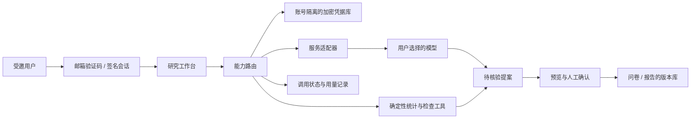

# 用户自带服务的正大杯 Agent 框架

设计日期：2026-10-07。产品决策：运营者托管网站，先面向自己与受邀队友内测；用户通过邮箱验证码登录，每个账号配置自己的模型服务。工作区中的真实调查与参赛材料继续受原有证据链约束。

## 产品结构

用户先配置服务商、模型 ID、API Key 与输出上限，再把一份配置绑定到一个或多个能力。同一能力可绑定多个配置，执行时明确选择；不自动换服务商或扩大资料发送范围。模型服务失效时，本地问卷编辑、基础统计和已有版本仍可使用。

| 部分 | 接入形式 | 本轮状态 |
|---|---|---|
| 选题与研究 | 模型适配器 + 独立检索适配器 | 可保存模型绑定；研究执行、检索适配尚待实现 |
| 问卷设计 | 模型提出结构化草案，工作台解析检查后确认应用 | 已实现第一条执行链 |
| 数据分析 | 确定性统计工具；模型负责解释提案 | 已有基础计算，尚未接入新模型解释链 |
| 报告写作 | 模型 + 证据引用 + 文档版本 | 可保存绑定；已有结构化编辑器，新模型写作链待接入 |
| 答辩准备 | 模型 + 问题主题 + 项目证据 | 可保存绑定；已有训练工具，新模型问答链待接入 |
| 网页与文献检索 | 服务商专用 API 和来源协议 | 扩展契约设计，不冒充已联通 |
| DOCX / PPTX 原生编辑 | 文件存储与 ONLYOFFICE 的专用配置 | 原有适配层；真实引擎联调仍待验收 |

第一版使用 OpenAI Chat Completions 兼容的文本适配器，预置 OpenAI、DeepSeek、千问的固定入口。兼容网关须由运营者在服务端批准完整 Base URL，用户不能任意指定网络目的地。千问的区域和工作空间域名需要后续专门配置；不能默认跨区域密钥可用。

## 已落地的接入契约

- `ServiceConfig`：稳定 ID、名称、服务商、Base URL、模型、能力集合、输出上限、修订号。
- `MasterKey`：运营者在服务端配置 256 位主密钥和版本 ID；用户不接触主密钥。
- `callAgentProvider`：输入、输出、超时、错误、用量与目的地协议独立于网页和数据库。
- 用户配置最多 8 份；修改与移除须带预期修订号。更换服务商或地址需重新提供密钥。
- 密钥使用随机 96 位 IV 的 AES-256-GCM 加密，认证数据绑定账号、配置 ID、修订、主密钥 ID 及完整配置指纹。页面摘要不返回明文、密文或密钥尾号。
- 服务调用最多 30 秒，输入最多 32 KiB、响应最多 128 KiB，单次输出为 128–4096 tokens 且不能超过配置上限。拒绝重定向、工具调用、截断输出、密钥反射和原始上游错误泄露。
- 请求 ID 先写入数据库；同一 ID 不重放。同时最多运行 1 次，每个账号滚动一小时最多 12 次。超时或传输异常保留“结果未知”，不承诺未计费。
- 服务商没有提供合法用量时记录未知，不估造 tokens 或金额。调用日志不保存提示词、回答、Authorization 或 API Key。日志写入失败不会自动重发已经完成的生成。

## 登录与内测权限

验证码只发送到运营者配置的受邀邮箱，未受邀请求返回统一提示。核心实现包括随机六位验证码、HMAC 验证摘要、10 分钟有效期、最多 5 次尝试、60 秒重发间隔和滚动一小时最多 5 次发信预留。发信服务接受请求后才将挑战标为已投递；验证码必须原子消费，不能重放。

验证码通过后创建签名 HttpOnly / SameSite=Strict 会话，并将会话随机身份绑定到稳定账号。相同邮箱在不同设备验证后读取相同账号配置；其他邮箱不能访问。注销会在服务端撤销会话。每次访问再次检查受邀名单，移除邀请可停止旧会话对服务配置的访问。邮箱摘要是假名化信息，不能宣称抗字典攻击的匿名数据。

邮件适配器现提供 Resend 的固定 HTTPS 接口；接口可替换，账号与验证码协议保持一致。未配置发信服务时，邮箱登录关闭，不回退为匿名公网凭据库。本轮未发送真实邮件。

`EVI_X_AGENT_DEMO=1` 仅在回环地址允许合成会话，用于独立测试数据库；公网不能利用此标志绕过邮箱登录。合成验收页面明确提醒不填真实密钥。

## 第一条 Agent 执行链

1. 用户选择绑定问卷能力的配置，填写不超过 4000 字的研究需求。
2. 用户明确确认发送给该服务商并使用自己的额度。
3. 服务端核对身份、权限、配置修订、请求 ID 与调用限额，再解密本次所需密钥。
4. 模型只返回问卷提案。应用程序解析 3–8 道题、选项和问题—决策映射，拒绝重复 JSON 字段、未知结构与不完整内容。
5. 建议在服务页预览；用户带到问卷工作台后，再确认替换。当前设计进入撤销历史，后续使用现有问卷版本库保存。
6. 所有生成题项标为拟议、未预测试；来源和效度待核验。模型不能自行通过质量 Gate 或伪造真实调查。

本轮没有实现自主多步规划、真实项目自动执行、自动评委审查或完整比赛 handoff。后续每条能力都要有输入/输出 Schema、服务需求、权限、任务依赖、产物版本、复核人和质量闸门，沿现有 `agentctl` 权威控制面接入。

## 前后端分工

前端负责服务配置、能力选择、调用前的资料预览与授权、执行状态、提案预览、确认/取消/撤销。密钥只在密码输入框中暂存，保存后清空，不进入 LocalStorage、IndexedDB 或导出文件。

后端负责可信身份、邀请权限、加密凭据库、配置并发、工具注册、调用适配、配额、幂等与审计；统计结果和质量闸门由确定性工具及独立复核负责。未来任务执行器仅接受已注册工具和经授权的动作，模型输出不能成为任意代码、网络地址或系统命令。

正式内测前还需把已有报告、问卷和项目接口统一迁移到账号身份。旧入口仍包含 Sites 特定的身份头和匿名草稿 Cookie；本轮新服务凭据没有复用这些入口，但整站不能因此直接公开上线。

## 管理员部署配置

| 设置 | 用途 |
|---|---|
| `EVI_X_AGENT_MASTER_KEY` | 随机 32 字节十六进制主密钥；拒绝明显重复的占位值 |
| `EVI_X_AGENT_KEY_ID` | 主密钥版本 ID，默认 `v1` |
| `EVI_X_AGENT_ALLOWED_BASES` | JSON 数组，批准的兼容服务完整 Base URL，默认关闭 |
| `EVI_X_AGENT_INVITED_EMAILS` | JSON 数组，最多 100 个受邀邮箱，只保存在服务端 |
| `EVI_X_AGENT_MAIL_API_KEY` | 发信服务凭据，现对应 Resend |
| `EVI_X_AGENT_MAIL_FROM` | 已验证的发件邮箱 |
| `DB` | 已应用本项目迁移的 D1 数据库 |

主密钥、邮件密钥、邀请名单都通过部署环境的秘密配置渠道设置，不提交到仓库，也不填写到用户模型表单。主密钥应备份；当前没有透明的多版本 keyring，换主密钥后旧配置需要用户重新输入 API Key，不应直接替换主密钥造成不可读配置。

新增迁移为 `0016_agent_services.sql`、`0017_agent_calls.sql`、`0018_agent_accounts.sql`；本轮只在独立合成库验证，没有升级原工程的用户数据库。阿里云适配、正式 HTTPS、邮件真实投递、供应商真实生成及 ONLYOFFICE 都需要独立验收。

目前需要运营者提供：可用的服务器部署入口与实例配置；发信服务和已验证发件地址；首批受邀邮箱名单；正式域名与 HTTPS 安排。实际密码、API Key 和私钥应在对应设置或安全部署渠道输入。

## 技术来源

适配器参数核对自 [OpenAI Chat Completions](https://developers.openai.com/api/reference/resources/chat/subresources/completions/methods/create)、[DeepSeek 模型列表](https://api-docs.deepseek.com/api/list-models/)、[千问兼容接口](https://www.alibabacloud.com/help/en/model-studio/compatibility-of-openai-with-dashscope)；加密和秘密配置参照 [Cloudflare Web Crypto](https://developers.cloudflare.com/workers/runtime-apis/web-crypto/) 与 [Secrets](https://developers.cloudflare.com/workers/configuration/secrets/)；邮件接口参照 [Resend Send Email](https://resend.com/docs/api-reference/emails/send-email)。模型、区域和接口兼容性需在用户实际服务上测试，离线适配器测试不证明真实供应商联通。
