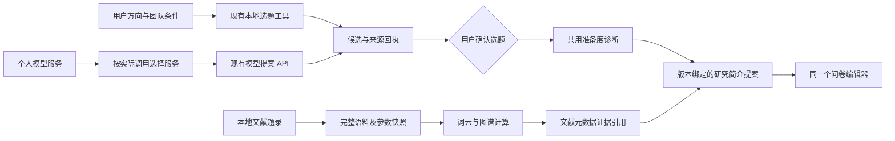

# Agent 研究入口与逐步骤模型配置

本次整合以 Agent 为主入口，把已有编辑器和确定性研究工具串在同一个项目范围里。它没有删除旧工作台，也没有新建第二套问卷、数据或报告编辑器。

## 用户如何使用

1. 在 Agent 的“模型配置”中添加个人模型服务，填写自定义名称、服务地址、模型标识、Key 与可用能力。Key 仍只交给已有服务端凭据系统，研究草稿不保存 Key。
2. 在“研究路线”输入方向，按需要补地区、学校、时间、经费和已确认的访问渠道。本地资料筛选不收费；未提供的资源不自动补成“已确认”。
3. 比较候选，修改题目与范围，点击“确认选题并继续”。默认在关键节点确认，其余已接通的步骤自动推进。
4. 确认后调用与诊断 API 相同的确定性计算。研究简介可以送入原问卷编辑器，由已有提案确认界面决定采用哪些字段。
5. 导入文献题录后，词云、共现网络、论文网络和突现分析使用同一语料与参数，保存来源、同义词和选择篮。没有语料时显示待补充，不生成虚构的文献分析。
6. 需要模型讨论时展开选题顾问，使用对应步骤保存的服务。已有调用确认、原请求对账、版本校验和提案采纳逻辑继续有效。

选题、问卷、发布与最终交付是默认人工确认点。缺少材料、不可用模型、冲突或未知收费回执也阻止继续。确认研究草稿不推进赛事阶段，不代表任何 CLI Gate 通过。

## 源码分工

| 位置 | 职责 | 不承担的职责 |
|---|---|---|
| `components/agent/AgentShell.tsx` | 同一个项目中的对话、研究路线、成果架、编辑器宿主及实际模型调用选择 | 统计公式、凭据存储 |
| `components/agent/ResearchWorkspace.tsx` | 首段流程、用户确认、草稿恢复、语料回执展示 | 云端选题版本的权威决策、长驻后台调度 |
| `components/agent/ResearchJourney.tsx` | 路线与逐调用模型选择的受控视图 | 假造步骤完成、自动调用模型 |
| `components/EviXPlatform.tsx` / `lib/workbench-handoffs.ts` | 复用问卷、分析、报告等实例；在账号/项目范围交接内容 | 全局跨账号事件总线 |
| `lib/agent/research-intake.ts` | 包装已有选题筛选、文档采纳及小语料分析工具 | 重新实现排名或统计公式 |
| `lib/project-diagnosis.ts` | API 与 Agent 共用的唯一准备度计算 | 获奖概率、Gate 决策 |
| `lib/topic-lab/workspace.ts` | 完整语料/参数快照、校验、确定性文献回执 | 联网搜索、证明全文已读 |
| `lib/agent/research-workspace.ts` | 浏览器 IndexedDB 检查点、范围隔离、修订冲突和删除墓碑 | 云端项目事实或长期任务队列 |
| `lib/agent/model-routing.ts` | 模型偏好的迁移、订阅与实际派发选择 | 模型优劣排行榜、Key |
| `skill/research-report-title/` | 版本化命名规范的唯一规范源 | 私人教材或整篇报告的分发 |
| `scripts/sync-research-title-skill.py` | 固定资源生成、版本绑定及 `--check` | 运行时任意文件读取 |

## 数据如何交接

原始文献及摘要保存在浏览器私有草稿中。简介中的文献引用携带来源 ID、选词及语料/参数/快照指纹，不默认把全文发给模型。题录分析与项目实证结果是两种证据，不能互相替代。

研究草稿记录 `profile`、`direction`、原选题回执、选中提案、诊断输入和计算结果、文献快照及自动推进偏好。恢复时重算诊断，核对文献哈希和选题输入绑定；旧来源回执可阅读，采用时必须再通过当前版本检查。保存采用 800ms 防抖，只有 IndexedDB 事务成功才显示保存完成。并发修订冲突保留当前编辑内容，不静默覆盖存储。

访客使用标签页范围 ID；登录账户与项目共同确定范围。切换视图继续使用原编辑器；切换账号或项目时更换整个范围，晚到结果不能进入新范围。

## 模型选择与费用边界

模型身份不是固定品牌名单。服务使用现有 `Service` 契约：`label`、`provider`、`baseUrl`、`model`、`capabilities` 与 `revision`。主页面的配置面板复用 `HostedServices`，没有第二套 Key 表单或前端明文 Key 槽位。

选择顺序：具体调用覆盖 → 任务类型默认 → 全局默认 → 只有一个符合能力的服务。显式选择失效时停止，不能偷偷切到另一家付费服务。

| 调用 ID | 实际调用位置 |
|---|---|
| `research.conversation` | Agent 对话 |
| `research.topic` | 选题顾问模型讨论，提示词包含已打包命名 Skill |
| `survey.questionnaire` | 问卷提案 |
| `report.draft` | 单章节起草 |
| `report.revision` | 单章节修订 |
| `report.full` | 整份报告候选稿 |

本地诊断、词云、数据检查等确定性工具没有假模型选择器。已提交调用冻结服务 ID、版本和原请求；修改偏好影响后续调用，不能把原请求换模型重发。等待前置读取期间发生模型或版本改变时，未发出的调用停止并要求重新确认。未知回执继续使用已有精确请求对账流程。

整稿每次运行仍绑定一个服务，不能把界面的逐调用选择理解为“整稿每章不同模型”。原服务端地址许可与 SSRF 校验保持有效；添加服务不表示允许任意内网端点。

## 已接通与后续边界

本批实际接通：研究方向、本地候选、命名 Skill 的真实模型提示词路径、选题确认、共用诊断、研究简介交接、文献快照及计算回执、现有模型调用的具体步骤选择。

后续模块仍可在 Agent 内打开原编辑器；未实现的后台执行器不会显示为自动完成。现有五角色后端框架的默认装配没有完整真实执行器，尚未实现关页后持续运行全部研究步骤。数据后台执行、整稿逐章节异构模型调度、完整跨端研究草稿同步和完整人工批准状态机，应分别实现和验收。

本批不更改首页、竞赛硬性规则、原始数据身份或真实/模拟分类。文献题录回执不是文献综述，选题草稿也不是已确认云端选题版本。
