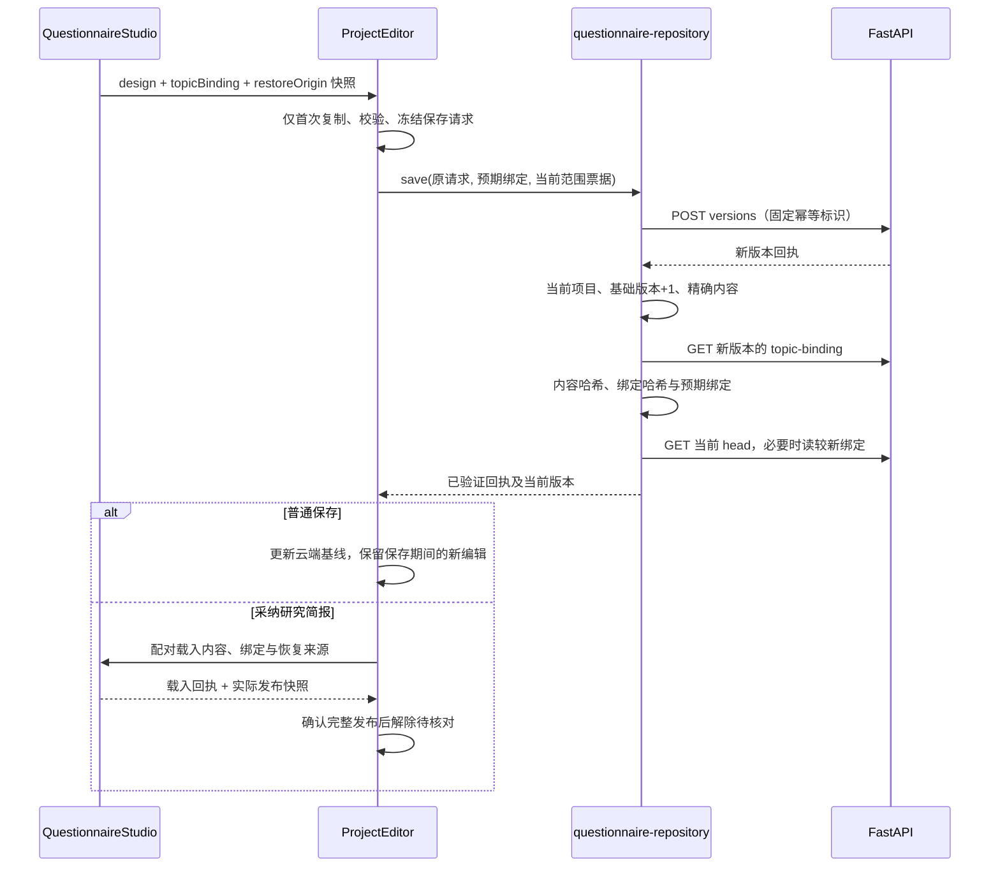

# 托管问卷：存取协议、来源绑定与恢复维护指南

本次拆出问卷存取协议，保留原问卷编辑器及其撤销栈。它处理网页项目的版本保存与恢复，不推进赛事阶段，不评定 CLI Gate，也不替代后端权限检查。

## 先读哪几个文件

路径相对仓库根目录。

| 文件 | 职责 | 不承担的工作 |
| --- | --- | --- |
| `apps/frontend/components/hosted/HostedProject.tsx` | 项目工作区、草稿与权限生命周期、选题采纳协调、编辑器配对载入、错误和冲突展示 | 问卷版本 HTTP 路径、保存回执结构判断 |
| `apps/frontend/components/hosted/questionnaire-repository.ts` | 项目范围内 head、版本目录、指定历史、绑定 sidecar 读取；保存回执与当前 head 的核对协议 | React 状态、撤销、提示框、缓存、自动重试 |
| `apps/frontend/lib/questionnaire-persistence.ts` | 新请求复制与冻结、项目范围、精确写入回执、历史版本和不可变 ID 校验 | 网络、身份、来源授权决策 |
| `apps/frontend/lib/topic-questionnaire-api.ts` | 选题采纳/恢复 mutation，以及绑定回执哈希核验 | 页面状态和问卷编辑 |
| `apps/frontend/components/design/QuestionnaireStudio.tsx` | 问卷内容、题目稳定 ID、未完成数值输入、撤销/重做；发布内容与绑定快照 | 云端版本目录、项目授权 |
| `apps/frontend/components/hosted/HostedSession.tsx` | 登录身份周期、标签页草稿缓存、CSRF 与 `mutate` | 问卷内容或研究来源是否一致 |
| `apps/backend/src/application/services/questionnaires.py` | 权限、预期版本与幂等检查，事务内保存版本与来源绑定 | 页面交互或前端撤销栈 |

这不是把 `ProjectEditor` 全部拆完：选题与问卷的生命周期协调仍在那里。后续应继续按领域控制器拆分，避免把整个页面原样搬成一个大 hook。本次新 repository 没有拥有页面状态。

## repository 接口

`createQuestionnaireRepository(projectId, transport)` 注入两个窄接口：`read` 和 `mutate`。同一项目与稳定的 `mutate` 生成一个实例，不依赖整份经常变化的 auth 对象。

| 方法 | 返回与约束 |
| --- | --- |
| `head(stillCurrent?)` | 当前项目问卷或 `null`；失去当前范围时返回 `undefined` |
| `bindingFor(head, stillCurrent?)` | 该不可变版本的来源绑定及哈希回执 |
| `versions(before?, stillCurrent?)` | 校验后的版本摘要分页 |
| `version(summary, stillCurrent?)` | 与所选摘要 ID、revision、标题均一致的历史问卷 |
| `save(request, expectedBinding, stillCurrent)` | 已核验的 `receipt / savedBinding / current / currentBinding`；失去当前范围返回 `undefined` |

`stillCurrent` 是宿主提供的范围票据：读取路径检查组件仍挂载、账户与 identityEpoch 和项目，允许有读取权限的用户查看；写路径额外检查当前写权限，采纳与恢复的调用还按需绑定草稿和来源修订。repository 在每次 I/O 前、await 后，以及异步哈希核验后检查这张票据。可选参数默认 `() => true`，repository 不自行鉴权，具体守卫必须由调用者传入。它阻止晚到结果写入当前页面；请求已经发出时，不能靠它撤销服务端提交。

`QuestionnaireSaveError` 保存原始错误 `cause` 和 `phase`：`mutation` 表示 POST 阶段，`verification` 表示 POST 返回后的内容、sidecar 或 head 核对阶段。UI 通过它区分拒绝与未知，不通过错误文案猜测。

## 保存的完成链



问卷、绑定和恢复来源必须作为同一编辑动作进入编辑器。载入回执本身不证明编辑器已发布完整状态；宿主还检查实际快照。`topicReconciliation.beforeBinding` 保留采纳前绑定，避免重试时把采纳后的绑定误当作撤销目标。

普通保存只更新保存基线，不重挂载编辑器、不替换后续输入。采纳时若草稿或选题来源已经变化，云端保存仍如实登记，页面保留新编辑并要求核对。

## 何时成功、冲突或保留原请求

新请求固定 `design`、`expectedRevision`、`idempotencyKey` 和可选来源 mutation。原草稿和 mutation 不被原地冻结；冻结的是已复制的请求。会话缓存中的旧待核对请求继续复用原对象和原 key。

| 情况 | 行为 |
| --- | --- |
| 本次写回执 = 基础版本 + 1，内容完全一致；当前 head 同 ID、同版本、同内容 | 可继续确认成功 |
| 当前 head 已更高，且使用另一不可变 ID | 本次已保存，但进入并发冲突；保留本地草稿 |
| head 跨项目、为空、倒退、同版本不同内容/ID，或高版本复用旧 ID | 保留原保存请求，等待核对 |
| **新请求首次** POST 返回确定的 4xx 拒绝 | 可解除本次待核对；409 显示冲突，403 降为只读 |
| POST 超时、5xx、无效回执，或 POST 返回后 sidecar/head 403/404 | 仍可能已提交，保留原请求及 key |
| **原结果未知后的重放**返回 403/409 | 只能说明本次重放被拒，不能否定原提交；继续保留原请求 |
| await 后切账户、切项目、卸载或失去写权限 | 不接纳晚到结果；当前范围仍有效时显示待核对 |

没有自动重试循环。`invalid_server_receipt` 即使带 4xx，也不能证明原写入未发生。

## 历史载入、撤销与缓存

历史载入必须绑定用户点击的那条摘要，不接受另一份结构合法的版本。载入前后检查草稿修订及权限；`pendingSave.current` 是硬性阻断条件，不能只依赖渲染时捕获的 `saving` 或 `saveUncertain`。旧历史回调也不能越过新产生的待核对请求。

问卷载入采用原来的用户确认机制。历史问卷及绑定进入同一个编辑器动作，可一起撤销；再次保存创建新版本。源版本不被覆盖。

父级使用 `identityEpoch:projectId` 作为工作区挂载边界。标签页缓存按账户和 `project:<projectId>` 隔离，保存草稿及待核对请求；它不是持久离线队列，刷新后恢复的是服务端已保存版本。不要为了自动保存、消息或版本状态给编辑器更换 key。

读取预算统一为 2,100,000 字节，覆盖现有绑定 sidecar；没有扩大问卷本身 300,000 字节的保存上限，也没有改变公共 API、数据库或来源授权。

## 修改时怎么验证

从 `apps/frontend` 执行：

```powershell
node --experimental-strip-types --test tests/questionnaire-persistence.test.mjs tests/hosted-recovery.test.mjs tests/topic-questionnaire-host.test.mjs tests/workbench-handoffs-integration.test.mjs
npm run typecheck
npm run lint
npm run test:unit
npm run build
```

纯契约覆盖 Unicode、规范化字段顺序、数组顺序、复制冻结和精确版本。宿主测试执行真实 repository 和原有配对逻辑，只控制 hooks 与 I/O；不要把它替换成固定成功的 stub。

桌面验收应覆盖：保存两版、载入指定历史、撤销、采纳简报、撤销采纳后保存、重新载入带来源版本后保存及刷新；另以受控故障验证 POST 后读失败、未知重试遭拒、账户变化、旧回调和新编辑保护。浏览器验收使用隔离测试库；测试通过不证明真实模型服务、生产邮件或原生办公软件已验收。

## 故障定位

| 用户看到的现象 | 先查 |
| --- | --- |
| 保存一直待核对 | repository 的失败阶段、原 key、新版本 sidecar/head；不要先清缓存 |
| 采纳已保存但编辑器未采用 | `loadPaired` 回执、实际快照、draftRevision、sourceEpoch |
| 撤销后来源不对 | 配对快照、`topicRestoreOrigin`、`topicReconciliation.beforeBinding` |
| 点 v1 却出现另一版本 | 摘要与实际返回的 ID/revision/title 是否一致 |
| 切账户后出现旧结果 | 身份周期 key、`currentAccount`、await 后票据检查 |

仓库中的 [工作台交接指南](workbench-handoffs.md) 解释跨模块提案；[报告存取指南](hosted-report-persistence.md) 解释文稿版本。三份文档分别对应交接、问卷存取和报告存取，不互相承担业务职责。
