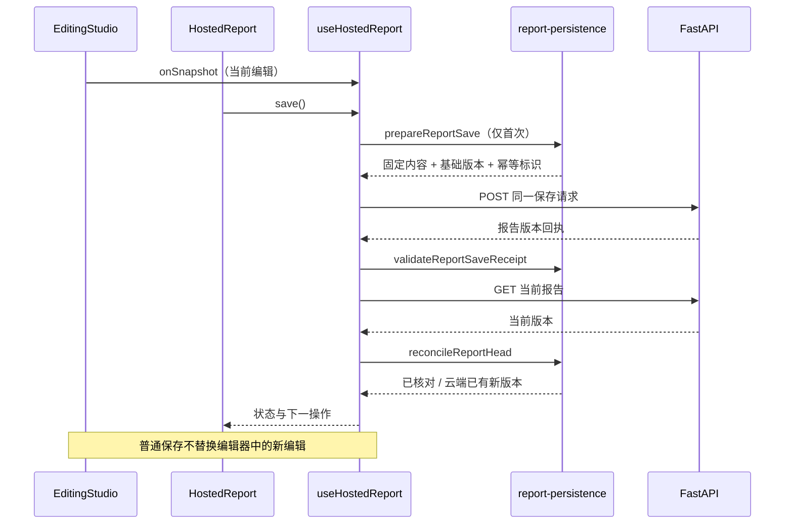

# 托管报告：保存、版本与恢复维护指南

托管报告现在按职责分为视图、生命周期控制器和回执校验。报告正文、PPT 对象、选区和撤销栈继续由同一个 `EditingStudio` 管理。这里描述的是网页报告的保存流程，不推进赛事阶段或 CLI Gate。

## 从哪里开始读

路径相对仓库根目录。

| 文件 | 负责什么 | 不应放入什么 |
| --- | --- | --- |
| `apps/frontend/components/hosted/HostedReport.tsx` | 工具栏、提案预览、版本按钮、编辑器引用和 JSX | 请求重试、回执判断、缓存恢复 |
| `apps/frontend/components/hosted/useHostedReport.ts` | 当前保存基线、草稿快照、权限周期、保存/载入/目录、忙碌与冲突状态、会话缓存 | 正文编辑、图表计算、Word/PPT 排版 |
| `apps/frontend/lib/report-persistence.ts` | 冻结新保存请求、校验保存回执、核对当前版本、精确历史版本与目录解析、完整文稿读取预算 | React、网络、登录凭据或自动重试 |
| `apps/frontend/lib/report-permission.ts` | 原有报告写权限票据；权限变化使旧票据失效 | 项目成员查询或授权决策 |
| `apps/frontend/lib/project-report.ts` | 报告类型、结构解析、语义内容比较、新报告与证据章节规则 | UI 操作状态 |
| `apps/frontend/components/editors/EditingStudio.tsx` | 正文/PPT/LaTeX 编辑、撤销、预览与导出；沿用共享权限票据 | 托管项目云端版本列表和保存恢复 |
| `apps/frontend/components/hosted/HostedSession.tsx` | 登录身份周期、会话内草稿、CSRF 与 `mutate` | 报告内容是否一致的判断 |

`EditingStudio` 继续导出 `createReportPermissionGuard`，兼容旧调用；函数只有 `lib/report-permission.ts` 这一份实现。



## 保存怎样确认成功

新保存先规范化并复制当前文稿，再冻结整份请求。固定 `content`、`expectedRevision` 和 `idempotencyKey`；后续输入产生新的编辑内容，不修改正在等待的请求。旧会话缓存中已有的待核对请求继续保留原对象和字段，不重新规范化或重新分配幂等标识，也不原地冻结可能与编辑器共享的缓存对象。

POST 回执必须满足：

1. 符合报告结构，属于当前项目，标题与内容一致。
2. 版本号恰好为 `expectedRevision + 1`。
3. 内容与固定请求语义相等，包括段落、PPT、格式和已保存的成果对象。JSON 字段顺序变化不算内容变化，数组重排和实际编辑算变化。

然后读取当前报告：

| 返回情况 | 处理 |
| --- | --- |
| 与保存回执同版本、同不可变 ID、同内容 | 更新云端基线，清除该次待核对请求 |
| 云端已有更高版本，且是不同的不可变 ID | 说明本次保存成功但已有后续版本；保留本地草稿并显示冲突 |
| 当前报告为空、落后、同版本不同 ID/内容，或更高版本复用同 ID | 回执尚未核对，继续保留原请求 |
| 保存期间用户继续输入 | 更新保存基线后仍显示新编辑未保存，不把编辑器替换成旧提交内容 |

版本一致性校验不证明用户的研究结论正确；它只确认文稿存取对应本次请求。分析与来源校验仍由各自领域模块负责。

## 失败、未知与重试

| 边界 | 待核对请求 | 可用操作 |
| --- | --- | --- |
| 新请求首次 POST 明确返回可解析的 4xx 拒绝 | 清除；409 另进入冲突 | 按错误修正或核对当前版本 |
| POST 超时、5xx、无效服务回执 | 保留同一请求 | 核对并重试原保存 |
| POST 已返回，后续内容校验或 GET 当前版本失败（包括 403/404） | 保留同一请求 | 核对原保存，不把 GET 错误当成 POST 被拒绝 |
| 原结果未知后的重放返回 4xx（包括 403/409） | 保留同一请求及幂等标识 | 这次重放被拒不能证明原请求没有提交；继续核对原保存 |
| 写权限周期改变，旧回调完成 | 不接纳旧回调；保留待核对请求并显示未知 | 当前权限允许后，用新票据核对同一请求 |

`invalid_server_receipt` 即使附带 4xx 状态，也不能用来证明原写入已被拒绝。未核对期间，载入最新/历史版本的处理器同时检查 `pending.current`，不能只依赖某次渲染捕获的 `uncertain` 状态；这能防止旧载入回调抛弃原保存。

`save()` 在开始时直接读取 `pending.current`，记录本次是否创建新请求，不依赖渲染闭包中的 `uncertain`。来自当前实例或会话缓存的待核对请求都算重放。只有新请求首次 POST 的确定拒绝可以清除请求；重放被拒、内容校验失败、后续读取失败均保留。原保存核对成功后才清除，之后新建的请求重新按首次调用判断。

这里没有自动重试循环。用户显式核对时重用同一请求，服务端按现有幂等协议处理。请求是否被处理仍由服务端回执证明，不能因网络异常或重放遭拒推断未保存。普通保存和核对均不替换用户随后编辑的正文或 PPT。

## 载入版本与编辑器生命周期

载入先读取当前基线，再按需读取指定历史版本。指定历史版本的返回 ID 必须等于用户所选 ID。读取期间出现新编辑或权限周期变化时拒绝替换；有未保存内容时沿用确认流程。

明确载入成功会增加 `generation` 并重新建立编辑器内容，这是已有的版本替换行为。普通保存、模块隐藏/显示、提案交接都不改变该 key。重构时不要把 `head.revision`、消息编号或 `busy` 当作编辑器 key，否则会意外清空撤销栈和输入状态。

版本目录独立分页，每页最多 30 项；目录用摘要解析，具体载入才读取完整内容。目录请求带递增序号，旧目录晚到不会覆盖新目录。错误不会被包装成空的成功目录。

## 大报告的读取边界

文稿原有容量上限是 `EDITOR_LIMITS.bytes = 2,000,000`。通用 HTTP 客户端默认只读 1,000,000 字节，不能直接用于完整报告。

完整 head、历史文稿和 POST 保存回执使用 `REPORT_READ_OPTIONS`：文稿上限加 16,384 字节 JSON 包装预算。版本目录继续使用摘要读取。这个调整没有扩大可保存的文稿大小，也不取消超限检查。

`HostedSession.mutate(path, body, 'POST', REPORT_READ_OPTIONS)` 的读取选项在第四个参数；放在第三个参数会被误认为 HTTP 方法。新建调用时需同时检查写入回执与后续 GET 的预算。

## 身份范围与缓存

`useHostedReport` 每次挂载对应一个账户/项目。它依赖现有 `HostedSessionProvider` 的 `identityEpoch` 边界，以及 `ProjectEditor` 的 `identityEpoch:projectId` key 卸载旧范围。不能在同一个实例中任意切换项目 ID 或账户，声称 hook 会自动迁移全部本地状态。

缓存仍在 `HostedSession` 的标签页内存中，键为 `report:<projectId>`，按账户隔离。它保留草稿、保存基线、待核对请求和冲突标记。该缓存不是长期离线队列，刷新后主要恢复服务端已保存版本；新 hook 没有新增浏览器持久化或后台任务。

共享权限票据只约束页面里的旧写回调，实际项目读写授权继续由后端执行。当前 viewer 可以主动读取项目允许的报告，但不能保存、修改或接受写入提案。

## 修改后的验证入口

在 `apps/frontend` 执行：

```powershell
node --experimental-strip-types --test tests/report-persistence.test.mjs tests/report-save-retry.test.mjs tests/project-report.test.mjs
node --experimental-strip-types --test tests/hosted-recovery.test.mjs tests/report-readonly.test.mjs
npm run typecheck
npm run lint
npm run build
```

纯函数用例覆盖固定请求、中文和 Unicode、格式字段重排、错误项目/内容/版本、当前版本核对、历史 ID、目录及超过旧 1MB 读取上限的合法报告。

宿主测试通过 `tests/helpers/hosted-report-hook.mjs` 执行实际 hook，与受控 React hooks、网络边界和编辑器接口配合。检查恢复、迟到回执、继续编辑、撤权再恢复、未知请求及读取预算。不能用固定返回值替代 hook，否则页面测试会跳过本轮最需要维护的逻辑。

这些 harness 用例不构成真实 DOM、原生输入法或焦点测试。浏览器观察、生产构建与单元测试需分别记录。本轮没有拆解问卷保存控制器，也没有改变后端保存、文档排版或原生 Office 导出逻辑。
