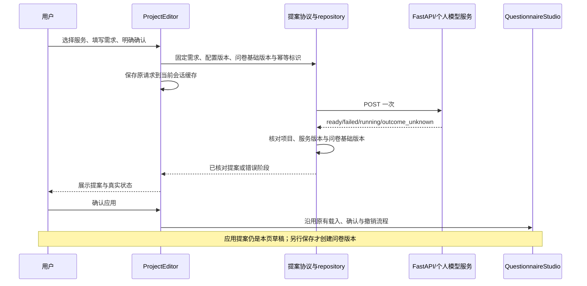

# 问卷模型提案：调用协议与维护入口

这一层把用户已确认的研究需求交给个人模型服务，接收一份待预览的问卷提案，并提供调用记录与核对入口。它不会替用户保存问卷，不推进赛事阶段或 Gate。已有问卷内容、稳定题目 ID、选题来源绑定与撤销栈继续由原编辑器和问卷存取流程维护。

## 按职责找代码

| 文件 | 负责什么 | 不应放入什么 |
| --- | --- | --- |
| `apps/frontend/lib/questionnaire-proposals.ts` | 固定新请求、检查用户确认、核对回执项目/服务配置/问卷版本、解析调用目录及指定提案 | React 状态、网络、密钥、重试循环 |
| `apps/frontend/components/hosted/questionnaire-proposal-repository.ts` | 项目范围内的 generate、get、list；await 前后票据检查；区分发出请求与回执校验的错误 | 编辑器、缓存、自动调用或批准 |
| `apps/frontend/components/hosted/HostedProject.tsx` | 表单、当前提案、请求同步锁、账户/权限周期、标签页缓存、用户主动核对、展示与确认应用 | 生成接口路径及各字段的回执校验规则 |
| `apps/frontend/components/hosted/HostedSession.tsx` | 登录范围、CSRF、个人服务调用、会话内草稿与离开提示 | 问卷研究内容是否合理 |
| `apps/backend/src/application/services/proposals.py` | 项目/个人服务授权、版本、幂等记录、次数限制、供应商调用与未知结果登记 | 页面草稿和编辑器撤销 |

本次拆的是调用协议。表单和项目生命周期仍留在 `ProjectEditor`，没有把父组件整体搬成另一个大 hook，也没有声称所有前端耦合已经消除。

## 这个模块拥有的工具

`createQuestionnaireProposalRepository(projectId, transport)` 仅接收 `read` 与 `mutate` 两个窄接口。每个项目及稳定的 `mutate` 对应一个实例。

| 方法 | 私有接口 | 含义 |
| --- | --- | --- |
| `generate(request, current)` | `POST /api/projects/:projectId/proposals` | 发出一次已确认请求，或由用户明确核对原请求 |
| `get(identity, current)` | `GET /api/projects/:projectId/proposals/:id` | 读取已知调用状态，不重新调用模型 |
| `list(current)` | `GET /api/projects/:projectId/proposals` | 读取本项目由当前用户发起的最近 50 条记录 |

这些工具限定在当前项目，使用用户选择的个人模型服务，不主动读取原始答卷，也不直接写入问卷版本。发送的是用户确认的研究需求；用户自己填入的文字仍属于该载荷。真实密钥由现有后端凭据服务管理，前端请求只包含服务 ID 和精确配置版本。

`current` 由宿主提供，是本地生命周期票据，不是服务端授权。读取检查当前挂载、账户、身份周期和项目；生成额外绑定写权限周期。票据失效后停止接纳回执，但不能撤销已经到达服务端的调用。后端仍执行实际权限和 Key 隔离。

## 与问卷编辑器怎样协作



保存期间或模型运行期间，问卷可以产生新版本。模型回执按原请求核对，不拿新草稿冒充原输入；提案基础版本落后时保留供查看，沿用原有版本限制，不覆盖较新问卷。

## 固定的输入与可核对的输出

新请求包含：`serviceId`、`serviceRevision`、`brief`、`expectedQuestionnaireRevision`、`idempotencyKey`、`consent: true`。

仅首次构造新对象并冻结；研究需求按现有网页限制为 1–6,000 字符，去除首尾空白，保留中文、Unicode 与中间换行。修改服务或需求后，用户需重新确认。已有待核对请求继续使用原对象与原幂等标识，不因表单或问卷后来变化而改写。

POST 回执必须属于当前项目，服务 ID、配置版本及输入问卷版本均与原请求一致。GET 指定提案还要核对所选 ID，以及已知的不可变服务、配置、输入版本和创建时间；状态可从 running 变为 ready。非 ready 状态不能夹带可应用设计。调用目录拒绝跨项目或重复 ID。

当前 API 没有回传研究需求的内容哈希。这些检查能证明项目与调用元数据对应，不独立证明模型的每句话如何产生；研究质量仍需用户审阅，生成内容本身不等于调查事实。

## 失败、未知与主动核对

| 情况 | 原请求与下一动作 |
| --- | --- |
| 新请求首次 POST 返回已核实的调用前拒绝码 | 解除本次待核对，保留当前问卷；按错误修正后另行发起 |
| 即使首次请求返回 401/403/404、通用 4xx 或未知业务码 | 保留原请求；后端可能在结果提交后才检查会话或项目权限 |
| 网络异常、超时、5xx、无效回执，或回执项目/配置/版本不符 | 保留原对象与 key，等待用户核对 |
| 原结果未知后的重放返回 403/409 等 4xx | 保留原请求；本次被拒不能证明原调用没有被处理 |
| `invalid_server_receipt` 即使带 4xx | 继续保留，不把无法核对的返回当成确定拒绝 |
| 已收到有效 running/outcome_unknown 提案 ID | 保留该提案及真实状态；可 GET 核对已登记结果，不自动重新调用模型 |
| 生成中切账户、卸载、撤权再恢复 | 不接纳旧回执；当前范围仍存在时保留待核对状态，不能用恢复后的权限接纳旧操作 |

`QuestionnaireProposalError.phase` 区分 HTTP `request` 与 `receipt` 校验，保留原始 `cause`。HTTP 请求失败不等于供应商尚未执行。只有首次请求的已核实前置拒绝能解除原请求：409 的 `revision_conflict / idempotency_conflict`，422 的 `consent_required / capability_unavailable / sensitive_input`，429 的 `call_active / call_rate_limit`。这份白名单对应 `ProposalService` 调用供应商之前的分支；修改后端顺序时必须重新审核。其他返回继续保留，不能从状态码或文案猜测是否已计费。repository 没有轮询、自动重试或定时重发。

## 并发、缓存和晚到结果

- `generationOperation` 在 await 之前同步上锁，覆盖生成、打开提案和核对状态；快速双击不等待 React 重新渲染才阻断第二次请求。
- 每个写权限周期有独立 epoch。撤权再恢复不会使旧生成回调或旧回执重新有效。
- `callsEpoch` 为调用目录读取编号；页面接纳新提案或状态回执后，旧目录晚到不能把新记录擦掉。
- 生成中及待核对状态参与当前会话的脏标记和离开提示。旧缓存即使漏存 `generationUncertain`，只要 `pendingGeneration` 仍在就推导为待核对。
- 缓存继续使用既有账户隔离的 `project:<projectId>`，没有新建重复状态权威。它是标签页内存；刷新、退出或换账户不是长期离线恢复保证。已登记提案可重新读取服务端记录。

问卷保存与模型生成分别拥有请求和幂等标识。共用 `persistProjectDraft` 组合会话快照；问卷保存的 `persistPending` 只额外设置保存待核对标记，模型生成不借用它冒称问卷保存未知。

## 验证与故障定位

从 `apps/frontend` 执行：

```powershell
node --experimental-strip-types --test tests/questionnaire-proposals.test.mjs tests/questionnaire-proposal-host.test.mjs
node --experimental-strip-types --test tests/hosted-recovery.test.mjs tests/topic-questionnaire-host.test.mjs tests/workbench-handoffs-integration.test.mjs
npm run typecheck
npm run lint
npm run test:unit
npm run build
```

纯协议测试直接使用真实解析器和 repository。宿主测试执行实际 `ProjectEditor`、调用协议及来源核验，只控制 hooks 和 I/O，覆盖错误元数据、重复点击、未知重试、账户/权限变更、旧目录和离开提示。它们不是浏览器布局或真实供应商服务验收。

| 现象 | 先查 |
| --- | --- |
| 需求框被锁定、原调用仍待核对 | `pendingGeneration`、原 key、错误阶段和服务端调用记录 |
| 有回执但不显示为可应用提案 | 项目、服务/配置、输入问卷版本及当前权限票据 |
| 最近调用记录突然变少或状态回退 | `callsEpoch` 与触发目录刷新/提案更新的时序 |
| 撤权后旧结果回到页面 | `generationPermissionEpoch`、`generationWriteEpoch` 和账户范围 |
| 应用后尚未出现在云端问卷历史 | 提案应用只改变草稿，核对问卷保存流程及其版本回执 |

相关维护入口：[问卷存取](hosted-questionnaire-persistence.md)、[模块交接](workbench-handoffs.md)、[报告存取](hosted-report-persistence.md)。
