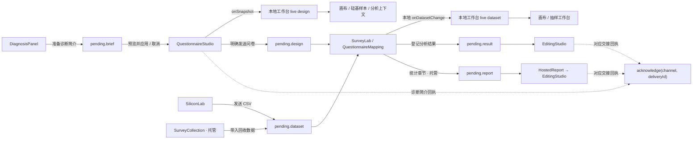

# 工作台模块交接维护指南

工作台通过一个内存控制器传递跨模块的提案和快照。`EviXPlatform` 与托管项目内的 `ProjectEditor` 共用这份协议，各自拥有独立实例。它解决的是“这次交接传了什么、哪个消费回执可以清除它”，编辑器的正文、问卷历史、撤销栈、云端保存和恢复状态继续由原组件管理。

## 数据流与状态归属



图中的 `pending.*` 属于当前宿主的控制器。`questionnaire` 另有类型槽，目前没有接入生产者；图中不将它画成可用路线。

控制器包含两种不同用途的状态：

| 状态 | 类型与含义 | 当前接线 |
| --- | --- | --- |
| `snapshot.design` | `DesignSnapshot \| null`，供其他模块观察的当前问卷快照 | 本地工作台用 `setDesign` 更新；编辑中的 `pending` 数值状态也随快照传递 |
| `snapshot.dataset` | `DatasetValue \| null`，解析完成的当前分析数据快照 | 本地工作台用 `setDataset` 更新，供画布和抽样模块读取 |
| `snapshot.pending[channel]` | `Envelope<Payload> \| null`，该频道最近一次交接 | 两个宿主均通过 `publish` 发送，读取 `payload` 交给消费者 |

两个 live snapshot 的更新不会清除任何提案槽；消费一个提案也不会清除 live snapshot。发送问卷到分析时，本地宿主会更新 live design，并另发一个 `DesignTransfer`。之后继续编辑问卷只更新 live design，已发送的设计版本保持固定。

托管项目仍使用原有 `snapshot`、`latest`、`draftRevision` 与缓存维护问卷保存桥接，没有将这份编辑状态迁入 `exchange.design`。其跨模块设计和数据传输进入共享协议的 `pending.design`、`pending.dataset`。

## 六个频道的实际状态

| 频道 | Payload | 生产者与消费者 | 当前回执 |
| --- | --- | --- | --- |
| `design` | `DesignTransfer` | 两个宿主的问卷编辑器 → `SurveyLab` → `QuestionnaireMapping` | 没有接入控制器 ack；保留原有显示与手动采用语义 |
| `dataset` | `DatasetTransfer` | 两个宿主的硅基样本；托管项目的发布回收 → `SurveyLab` | 没有接入控制器 ack；保留原有读取语义 |
| `brief` | `DiagnosisBriefSource` | 本地 `DiagnosisPanel` → `QuestionnaireStudio` | `onBriefHandled` 绑定本次交接；诊断输入失效的 `null` 回调也只确认该次渲染绑定的交接 |
| `questionnaire` | `AgentQuestionnaireProposal` | 保留类型契约，当前两个宿主均未接入生产者 | 没有活跃接线；不能据此宣称模型问卷草案已接通 |
| `result` | `ResultSnapshot` | 两个宿主的 `SurveyLab` → `EditingStudio`，托管侧经过 `HostedReport` 转发 | `onResultHandled` 绑定本次交接 |
| `report` | `ReportProposal` | 托管分析的统计段落 → `HostedReport` → 编辑器 `appendSection` | 添加成功或取消时调用绑定后的 `onProposalConsumed` |

`design` 消费者收到新 `payload.id` 后打开问卷对应区域；用户仍需点击“使用收到的问卷”。回收数据固定使用发布问卷时，原有固定版本规则继续生效。不要在消息首次显示时就清空该槽，否则尚未采用的快照会消失。

`dataset` 消费者使用 `handledTransfer` 按 `payload.id` 防止重复读取，经过原来的替换确认、CSV 解析、哈希和数据身份检查。标记发生在读取前，因此取消或读取失败也不等于可自动重试的待办项。新的协议没有改变这个行为，也没有把“已到达”提升为“已成功载入”。

控制器每次 `publish` 都生成新的 `deliveryId`，即使 payload 中的业务 ID 相同。`design`、`dataset` 的现有消费者仍按 payload ID 判断新传输；生产者应继续为明确的新传输生成新的 payload ID。传输层的新编号不自动改变消费者的去重策略。

图表与答辩没有独立的交接槽：

- 图表由编辑器内部的 `QualityStudio` 使用已登记 `ResultSnapshot` 的证据 ID 和数值列生成，随 `EditorContent` 保存。
- 托管答辩通过 `HostedDefense` 显式读取已保存报告，再由 `projectDefenseSource` 校验项目并生成版本与内容哈希。它不会自动接收尚未保存的报告正文。`DefenseStudio` 的演练笔记继续保留在自身组件状态中。

## 发布、不可变快照与精确回执

```ts
const deliveryId = store.publish('result', result);
// pending.result = { deliveryId, payload: detachedResult }
```

`publish` 先用 `structuredClone` 复制 payload，再递归冻结对象与数组，随后替换该频道槽并通知订阅者。`setDesign`、`setDataset` 使用同样的复制与冻结规则。生产者之后修改自己的对象，不会改变已发布内容；消费者需要编辑时，应创建自己的新对象。当前 payload 契约由普通记录和数组构成，不应塞入组件、回调、DOM 节点或其他运行时资源。

复制失败或频道未知时，发布不改变现有快照。控制器负责传输与隔离，不负责替代问卷、统计结果、来源或项目权限的领域校验；原有解析与校验仍要保留。

`deliveryId` 是交接编号，payload 的 `id` 是业务对象编号。二者用途不同。默认交接编号由 `crypto.randomUUID()` 生成；测试注入的 `makeId` 也必须每次返回新编号。

```text
publish(result, A) → delivery-A
publish(result, B) → delivery-B
acknowledge(result, delivery-A) → false，B 保留
acknowledge(result, delivery-B) → true，该槽清空
再次 acknowledge(result, delivery-B) → false
```

消费回执只在频道和当前 `deliveryId` 都匹配时生效。旧回执、其他频道回执、空槽回执都不能删除新内容。

宿主通过薄 hook 将现有无参消费回调绑定到本次渲染看到的交接：

```tsx
const { store, snapshot } = useWorkbenchHandoffs(scope);
const onHandled = useHandoffAcknowledgement(
  store,
  'result',
  snapshot.pending.result?.deliveryId,
);

return (
  <EditingStudio
    resultProposal={snapshot.pending.result?.payload}
    onResultHandled={onHandled}
  />
);
```

不要将回执改成“调用时查找当前消息后清除”，那会让 A 的迟到完成误删 B。也不要用业务 ID 代替 `deliveryId`，因为同一个业务对象允许再次发送。

ack 表示对应交接已被处理，不是“内容已保存到云端”的证明。例如结果消费者的重复结果或格式错误分支也会调用原有 handled 回调。云端成功与否仍取决于原保存流程及其回执。

## 实例、身份与编辑器生命周期

`useWorkbenchHandoffs(scope)` 用 `useMemo` 为 scope 创建实例，通过 `useSyncExternalStore` 订阅稳定快照。不要把实例提升为模块级单例，也不要跨项目复用。

| 宿主 | scope |
| --- | --- |
| 本地工作台 | `JSON.stringify(['workspace', userIdOrNull, identityEpoch])` |
| 托管项目 | `JSON.stringify(['project', userIdOrNull, identityEpoch, projectId])` |

身份或项目改变会选用新的空实例。旧闭包仍可能持有旧实例，但它对旧实例的发布或回执不会改变新实例。这不等于取消全部旧网络请求或撤销旧权限票据；`HostedSession` 的身份 generation、账户检查、草稿清理和各编辑器原有的异步保护仍须保留。

`HostedProject` 以 `identityEpoch:projectId` 为 `ProjectEditor` 的 key，`HostedSession` 也保留身份 epoch 边界。它们用于账户和项目切换，不能换成每条消息的 `deliveryId`。

普通模块切换保持现有编辑器：

- `WorkbenchShell` 保存已访问面板，使用固定面板 key 和 `hidden` 切换显示。
- 托管项目首次打开模块后保留其子树，再用 `hidden` 切换显示。
- 问卷与报告正文、选区、输入法状态、撤销栈和云端恢复记录没有迁移进交接控制器。

新增消息不得通过重建编辑器来实现消费。特别是不要给 `EditingStudio`、`QuestionnaireStudio` 或其外层容器绑定消息编号 key。

## 文件职责索引

以下路径均相对仓库根目录。

| 文件 | 职责 |
| --- | --- |
| `apps/frontend/lib/workbench-handoffs.ts` | 六频道类型、两份 live snapshot、复制与冻结、发布、精确 ack 和订阅 |
| `apps/frontend/components/workbench/useWorkbenchHandoffs.ts` | 实例选择、React 订阅、为无参消费回调绑定交接编号 |
| `apps/frontend/components/EviXPlatform.tsx` | 本地宿主的频道接线、live snapshot 接线和导航 |
| `apps/frontend/components/hosted/HostedProject.tsx` | 托管宿主接线、项目与账户范围；保留原问卷保存桥接 |
| `apps/frontend/components/WorkbenchShell.tsx` | 本地已访问模块持续挂载 |
| `apps/frontend/components/design/QuestionnaireStudio.tsx` | 问卷快照生产、设计显式发送、简介预览与应用 |
| `apps/frontend/components/analysis/SurveyLab.tsx` | 设计/数据接收、结果登记和统计段落生产 |
| `apps/frontend/components/analysis/QuestionnaireMapping.tsx` | 手动采用收到的问卷及对应确认 |
| `apps/frontend/components/hosted/HostedReport.tsx` | 统计段落预览、结果转发、原报告云端保存 |
| `apps/frontend/components/editors/EditingStudio.tsx` | 编辑器自身状态及结果消费；保留原撤销和保存流程 |
| `apps/frontend/components/hosted/HostedDefense.tsx` | 已保存报告的答辩参考读取，独立于本交接槽 |
| `apps/frontend/tests/workbench-handoffs.test.mjs` | 纯控制器测试 |
| `apps/frontend/tests/workbench-handoffs-integration.test.mjs` | 实际宿主回调、真实 hook 和控制器的集成边界测试 |
| `apps/frontend/tests/helpers/workbench-test-harness.mjs` | 在受控 React hooks 中执行真实交接 hook，订阅真实 store |

## 新增频道的步骤

1. 先说明生产者、消费者、payload 类型和用户触发动作，确定是持续快照还是一次交接。只有类型槽而没有接线时，明确记录为未接入。
2. 在 `WorkbenchPayloads` 添加类型，在初始 `pending` 添加空槽。payload 应保留业务 ID、来源和版本字段；传输编号继续由控制器生成。
3. 在相应宿主使用 `publish`。领域校验、写权限检查与导航由原宿主/消费者负责；控制器不发网络请求，也不自动保存。
4. 将冻结后的 `payload` 传给现有消费者。若消费者需要持续保留输入，先明确何时算处理完成，再决定是否接入 ack。
5. 若接入 ack，用 `useHandoffAcknowledgement` 绑定本次渲染的 `deliveryId`。为成功、取消、重复、失败和异步迟到分别规定行为，不能用清空当前槽代替回执。
6. 添加纯控制器测试与实际宿主接线测试：A→B→旧 ack、同业务 ID 重发、跨频道隔离、嵌套对象修改、scope 改变及旧闭包。确认编辑器 key 和原云端保存行为未被改变。
7. 做受影响工作流的浏览器检查：发送、预览、采用/取消、切换模块、返回编辑器、继续输入与撤销；需要账户/项目边界时测试对应切换。将观察结果与自动化测试结果分别记录。

每个频道是一个保存最新交接的槽。B 会替换尚未确认的 A，系统没有后台待办队列、消息历史、持久化、刷新恢复、自动重试或至少一次/恰好一次投递承诺。需要这些能力时，应另行设计持久化与重放协议，不能把当前 `pending` 当作可靠任务队列。

## 验证命令与证据边界

在仓库根目录进入前端目录后执行：

```powershell
Set-Location apps/frontend

# 纯控制器与实际宿主接线
node --experimental-strip-types --test tests/workbench-handoffs.test.mjs tests/workbench-handoffs-integration.test.mjs

# 原保存恢复、权限、选题应用与视图切换回归
node --experimental-strip-types --test tests/hosted-recovery.test.mjs tests/topic-questionnaire-host.test.mjs tests/report-readonly.test.mjs tests/research-view.test.mjs
```

纯控制器测试覆盖所有频道的精确 ack、独立实例、订阅、深层冻结和复制失败；另用真实合成分析结果检查数值与证据哈希，使用 200,000 个单元格的合成数据检查快照和 CSV 没有截断。这些检查不代表真实模型效果或真实数据来源已获认证。

宿主集成测试执行完整宿主模块、真实 `useWorkbenchHandoffs`、真实控制器和生产回调；子编辑器与网络 I/O 在接口处受控。它们能检查旧回执、重复业务 ID、数据隔离、导航回调、身份边界，以及返回的隐藏子树和稳定 key。它们没有模拟真实 React DOM 调和，不能单独证明原生焦点、输入法组合、编辑器实例和撤销历史均通过浏览器验收。

`hosted-recovery` 与 `topic-questionnaire-host` 已改为在 harness 中执行真实交接 hook，原来的保存不确定性、迟到保存回执、配对版本应用和恢复断言继续运行。本次交接重构不将本地消息回执替代服务端保存回执。

维护时应同时保留单元/集成测试日志、类型与 lint/build 结果，以及独立的浏览器观察记录。此文档说明当前代码契约与检查入口，不宣称尚未记录的浏览器验收已经通过。
